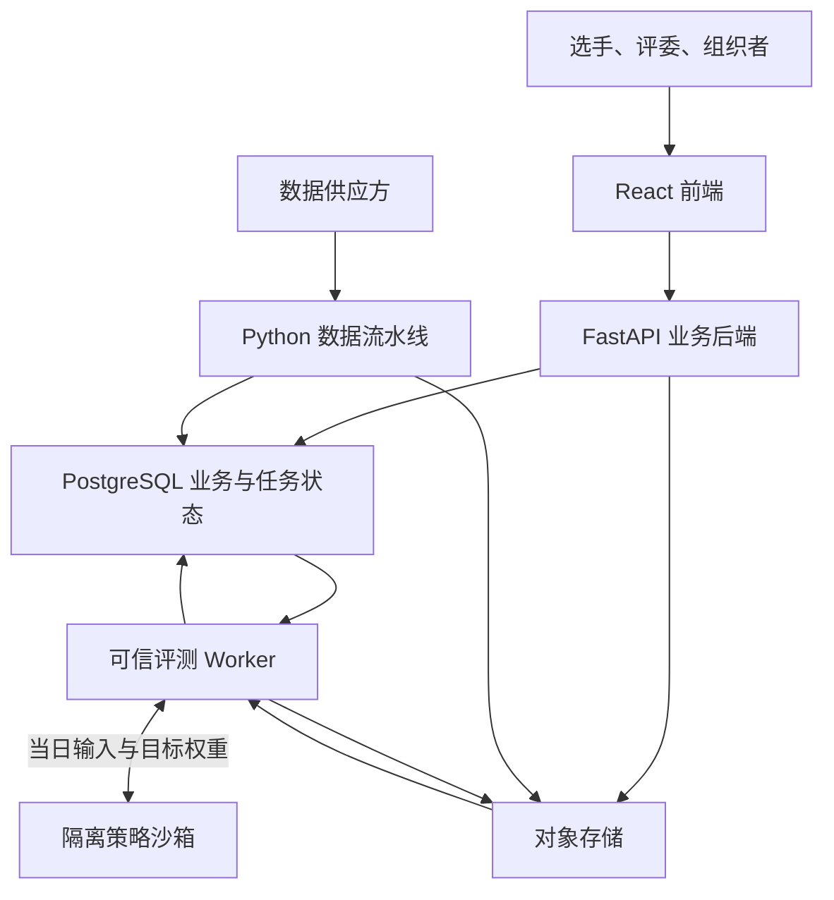

# 赛道 2 系统开发方案

依据[赛事设计第 2 节](第31届智能体大赛设计.md#2-track-2智能体解决真实问题)和[系统技术方案](README.md)编写。目标是交付从数据下载、策略验证、封榜、正式评测到报告评审与发榜的完整比赛系统。日频、目标权重接口、离线运行及下述技术选型是建议的开发默认值。赛事日期、股票池、资金、费率和评分权重由组委会赛前公布。

## 三人小队开工

第一轮骨架已包含 Web、HTTP API、独立 Worker、日频样例评测、固定输入和自动化联调。用人工行情先验证跨模块链路。首轮 HTTP 契约以 OpenAPI JSON 为准，下面的系统接口表也包含后续待开发内容。[启动说明](README.md#本地开发) · [当前接口](contracts/README.md)

| 负责人 | 首轮可认领任务 | 独立验收 |
| --- | --- | --- |
| A · Web | 在现有页面增加任务历史和净值图。补齐加载、失败、空仓和窄屏体验。按 OpenAPI 的类型维护客户端。 | 用样例响应验证页面，接真 API 完成一次策略验证 |
| B · 领队兼赛务与运行 | 负责接口合并和部署。实现账号与队伍归属、数据和任务的授权，随后接不可变策略包、正式运行时与持久存储。 | 两支队伍各自查询提交与结果，重复请求和 Worker 中断不产生重复任务结果 |
| C · 评测与数据 | 用数据方样本验证匿名字段和可见时间；完善停牌、涨跌停、公司行动及拒单记录；维护 SDK、人工账本和基线。 | CLI 独立运行，逐日账本与手算对齐，改变未来数据不会改变此前已发生的交易 |

以一周为一个迭代。每个迭代选一条能单独验收的业务流程，合入主线前一起完成实测。领队与改动涉及的消费者一起评审契约，兼容字段优先做可选新增，破坏性改动更新版本和样例。人少时把上线目标放在验证入口、冻结评测和榜单，页面和部署配置按当前里程碑增量补齐。

| 顺序 | 下一次可以演示的结果 |
| --- | --- |
| 1 | 网页保存内置策略、Worker 评测、查看净值和成交。以该流程验收骨架。 |
| 2 | 两队分别登录，授权样本进入评测，策略与结果互相隔离。完成受控策略包试运行。 |
| 3 | 完成封榜和正式批次，以历史数据走一遍数据锁定、评测重跑、报告评分与发榜。 |
| 4 | 按组委会确定的队伍规模验收隔离、容量、备份和故障恢复，再开放正式提交。 |

## 1. 总体架构

采用模块化单体后端，评测 Worker 独立部署。后端按账号、赛事、提交、任务和评分分模块。训练与验证使用按时间划分的 10 年和随后 1 年数据，封榜后一个月行情用于正式评测。



| 层 | 推荐技术 | 选择依据与职责 |
| --- | --- | --- |
| 前端 | React、TypeScript、Vite、React Router | 选手、管理和评审界面共享工程，用路由组织页面 |
| 前端交互 | Ant Design、TanStack Query、ECharts | 表格表单、请求状态与轮询、净值及回撤曲线 |
| API | Python、FastAPI、Pydantic | 数据校验、权限、赛务与任务编排，生成 OpenAPI 契约 |
| 持久化 | PostgreSQL、SQLAlchemy、Alembic | 业务数据、事务、任务队列及数据库迁移 |
| 文件 | S3 兼容对象存储 | 数据集、策略包、报告、日志和评测产物 |
| 数据和评测 | Python、PyArrow、NumPy、pandas | Parquet 数据构建、策略 SDK、日频评测器 |
| 部署 | Linux、反向代理、容器化 | Web/API 和评测节点分开，沙箱运行时通过隔离验收后接入 |

前端可用 Vite 的 React TypeScript 模板起步，后端接口与运行任务分进程部署。PostgreSQL 支持用行锁和 `SKIP LOCKED` 实现多 Worker 认领任务，适合首版统一存储任务与业务状态。依赖版本在脚手架联调后写入锁文件。[Vite 文档](https://vite.dev/guide/) · [FastAPI 后台任务说明](https://fastapi.tiangolo.com/tutorial/background-tasks/) · [PostgreSQL SELECT 文档](https://www.postgresql.org/docs/current/sql-select.html)

## 2. 前端开发

建议一套 Web 工程，面向参赛者、组织者和评委提供三组页面。桌面浏览器优先，基础阅读与提交状态支持窄屏。后端返回服务器时间、赛事阶段及可执行动作，前端据此显示截止时间和按钮状态。

| 页面 | 主要内容与操作 | 对接数据 |
| --- | --- | --- |
| 赛事首页 | 规则、赛程、教学材料、公告、报名入口 | 赛事和公告 |
| 队伍页 | 创建或加入队伍、查看成员、队长交接 | 当前用户、成员与邀请 |
| 数据与工具页 | 训练/验证包、字段说明、版本、SDK 与样例下载 | 可访问的数据版本和文件 |
| 提交中心 | 上传策略、包校验状态、提交历史、发起验证 | 上传会话、提交版本、配额 |
| 验证任务页 | 排队/运行状态、已完成交易日、错误原因、日志下载 | 任务状态、结构化错误、产物 |
| 结果页 | 净收益、回撤、费用、净值曲线、成交与拒单明细 | 结果摘要、曲线、分页交易记录 |
| 最终提交页 | 选择有效版本、展示包校验值、封榜回执 | 当前选择和冻结记录 |
| 报告页 | 上传报告及实验附件、确认报告版本 | 报告文件和截止时间 |
| 榜单页 | 验证结果展示及已发布正式总榜、各分项成绩 | 公开榜单版本 |
| 管理台 | 阶段配置、规则、数据发布、队伍、任务与 Worker 状态、封榜核验、重跑、发榜 | 管理接口与审计 |
| 评审台 | 分配的报告、评分细则、评语、暂存与提交 | 评审分配及个人评分 |

前端验收覆盖未登录、无权限、空结果、排队、超时、上传失败、封榜后操作和榜单尚未发布。任务页采用数秒级轮询，离开页面后停止。长曲线由后端返回展示采样，完整净值文件可下载。交易记录分页加载，日期明确显示北京时间，收益率与金额采用统一格式。

OpenAPI 生成 TypeScript 类型与请求代码，TanStack Query 管理服务器状态。前端维护少量登录状态和表单状态。图表只展示后端评测结果。封榜前后的并发操作以服务端响应为准，冲突时显示最终生效版本。

## 3. 后端业务模块

| 模块 | 负责实现 | 关键约束 |
| --- | --- | --- |
| 账号与权限 | 登录、会话、队伍成员、队长、组织者、评委角色 | 每个资源请求校验赛事和队伍归属，评委仅访问分配的报告 |
| 赛事配置 | 阶段时间、提交限额、规则及运行环境版本 | 阶段由服务端时钟判断，已生效配置可追溯 |
| 数据发布 | 数据目录、版本、下载授权、批次健康状态 | 正式执行数据只供可信评测组件读取 |
| 策略提交 | 上传、校验、版本编号、校验值、最终选择 | 已接收版本不可覆盖，新包生成新版本 |
| 评测任务 | 配额、入队、状态、重试、结果索引 | 任务创建与配额消耗在同一事务中完成 |
| 封榜 | 截止时原子锁定选择，生成冻结清单和回执 | 任何修改选择的请求都校验截止时间，并与封榜事务串行化 |
| 报告与评审 | 报告版本、分配评委、评分、评语和提交状态 | 评分关联固定报告与评分细则版本，修改留痕 |
| 榜单发布 | 计算量化分、汇总报告分、预览及发布 | 发布前检查权重、评审完成度、正式运行覆盖和同分规则 |
| 审计 | 操作者、对象、动作、原因、服务器时间、前后版本 | 冻结、重跑、数据更正和发榜均有记录 |

首版默认使用组织者发放的参赛邀请码注册，用户自行创建或加入队伍。登录采用服务端会话和 HttpOnly Cookie，写请求校验 CSRF。若学校提供统一登录接口，可在身份模块接入并映射为同一用户 ID。

上传流程采用“申请上传 → 写入临时对象 → 确认上传 → 后台校验”。平台重新计算校验值、限制包体与解压规模、拒绝越界路径和符号链接，确认完成后写入不可覆盖的对象。包结构检查与试运行分别记录，试运行在沙箱中进行。下载私有文件时先校验权限，再发放短时链接。

最终版本候选须通过包校验与规定的 SDK 冒烟检查。封榜事务同时锁定比赛阶段与队伍选择记录，保存代码包、环境镜像、SDK、规则和种子版本。正式数据快照在测试窗结束后单独锁定，再与冻结提交共同组成运行清单。

## 4. 核心 API

接口统一使用 `/api/v1`，列表使用分页参数。错误返回稳定的 `code`、可读 `message` 和追踪用 `request_id`。写入任务和提交完成请求支持 `Idempotency-Key`，相同键与参数返回同一结果，参数不同则返回冲突。

| 方法与路径 | 用途 |
| --- | --- |
| `POST /auth/login`、`POST /auth/logout`、`GET /me` | 登录、退出、用户与角色 |
| `POST /teams`、`POST /teams/join`、`GET /teams/{id}` | 建队、加入、成员查询 |
| `GET /competitions/{id}` | 规则、阶段、服务器时间和允许操作 |
| `GET /competitions/{id}/datasets` | 当前身份可访问的数据版本 |
| `POST /uploads`、`POST /uploads/{id}/complete` | 申请上传、服务端确认与校验入队 |
| `POST /submissions`、`GET /submissions` | 用已校验文件创建版本、查询本队提交 |
| `POST /runs`、`GET /runs/{id}` | 发起验证、查询状态和失败分类 |
| `GET /runs/{id}/metrics`、`GET /runs/{id}/equity`、`GET /runs/{id}/trades` | 摘要、曲线、分页成交 |
| `PUT /competitions/{id}/final-selection` | 队长选择最终版本并返回选择修订号 |
| `GET /competitions/{id}/freeze-receipt` | 本队冻结回执 |
| `POST /reports`、`GET /reviews/assignments`、`PUT /reviews/{id}` | 报告提交、评审任务、暂存或提交评分 |
| `GET /competitions/{id}/leaderboard` | 对当前身份可见的榜单 |
| `POST /admin/competitions/{id}/freeze`、`POST /admin/official-runs` | 执行到期封榜、按冻结清单创建正式批次 |
| `POST /admin/runs/{id}/retry`、`POST /admin/leaderboards/{id}/publish` | 故障重跑、发布已核验榜单版本 |

客户端发起验证只指定本队策略版本和允许的验证数据版本，实际规则、镜像和资源预算由服务端确定。正式任务创建和数据更正仅供组织者使用。前端提交最终选择时携带当前修订号，防止队内多个页面相互覆盖。

## 5. 数据库与对象存储

| 数据对象 | 主要字段 |
| --- | --- |
| `users / sessions` | 身份、登录凭据摘要、会话到期时间 |
| `teams / team_members` | 队伍、赛事、成员、队长角色；约束每人每场赛事最多加入一队 |
| `competitions / rule_versions` | 阶段时间、冻结状态、公开规则、费用、评分配置和配置校验值 |
| `uploads / artifacts` | 所属队伍、用途、大小、服务端校验值、对象键、状态 |
| `submissions` | 队伍、版本、文件、入口、SDK 和环境版本、校验及冒烟状态 |
| `dataset_versions / data_batches` | 数据区间、分区权限、清单校验值、完整性状态、来源记录 |
| `final_selections / freeze_records` | 唯一的赛事与队伍组合、选择修订号、冻结提交和回执 |
| `runs / run_attempts` | 运行清单、任务状态、幂等键；各次尝试的租约、心跳、错误、产物 |
| `reports / review_assignments / reviews` | 报告固定版本、评委、分项分数、评语、提交状态 |
| `leaderboard_versions / leaderboard_entries` | 结果批次、计分配置、发布状态与时间、每队分项和总分 |
| `audit_events` | 操作者、动作、对象、变更版本、时间与原因 |

数据清单、策略 ZIP、报告、逐日持仓、成交、净值和日志放对象存储，数据库保存元数据与产物索引。摘要金额使用定点数，权重使用整数基点。存储时间用带时区的 UTC 时间，交易日单独保存日期。训练/验证下载包、正式执行数据、提交文件和结果按访问角色设置独立权限与对象前缀。

## 6. 任务调度与评测 Worker

任务状态依次为 `QUEUED → RUNNING → SUCCEEDED` 或 `FAILED`。尝试记录另外维护租约令牌、到期时间、重试原因与次数。

1. API 在事务中检查阶段、队伍权限和剩余额度，创建带幂等键的任务，返回任务 ID。
2. Worker 用数据库行锁认领待运行任务，分配新的尝试编号和租约令牌。运行期间周期更新心跳。
3. Worker 按清单读取固定版本数据、规则、策略包和环境，启动沙箱并运行完整评测。
4. 产物先写到本次尝试的独立路径并核验。Worker 用当前有效租约条件提交结果和产物索引，事务成功后结果才可见。
5. 租约过期后，调度器记录本次尝试失效，按重试上限重新排队。旧 Worker 的迟到结果因令牌过期而被拒绝。策略超时、非法输出与平台故障分别归类，按赛前公布口径处理。

平台故障重试使用同一运行清单从头执行。正式数据更正创建新的数据版本和运行批次，需重算的队伍按统一范围重跑。API 和选手沙箱之间由可信 Worker 转发每日输入。Worker 持有的数据库、对象存储凭据及完整数据目录均在沙箱之外。

## 7. 评测器与 SDK

评测器实现为可独立使用的 Python 包，CLI 与线上 Worker 调用同一入口。

| 子模块 | 输出与验收 |
| --- | --- |
| 数据读取和时钟 | 按 `available_at` 提供当日可见因子，固定标的排序，校验时间和缺值 |
| 策略适配 | `KEEP` 保持，`TARGET` 输出整数基点权重；检查格式、标的和仓位上限 |
| 调仓转换 | 以决策时已知净值和标记价生成股数，按交易单位转换 |
| 成交与规则 | 下一交易日开盘参考价、先卖后买、T+1、涨跌停、停牌、资金不足和到期取消 |
| 账户与权益 | 现金、持仓、可卖数量、费用、分红送转与期末估值 |
| 指标与产物 | 净收益、最大回撤、逐日净值、费用、成交和拒单原因，输出版本化 JSON/Parquet |

SDK 提供 `initialize(context)` 与 `on_day(snapshot)` 两个入口。每个任务使用新实例，任务内保留状态。提交包包含 manifest、策略入口和所需离线模型，依赖使用平台公布的固定环境。JSON 消息定义模式版本和大小上限，金额以十进制字符串传递。SDK 配现金持有、买入持有、简单因子排序三个基线。

人工账本覆盖空仓、换仓、现金不足、T+1、停牌、涨跌停、费用舍入、公司行动及期末持仓。验证“改变未来行情不影响之前决策和成交”，以及重复运行的决策、账本、指标一致。日频成交假设和账户起止处理见[系统技术方案](README.md#4-日频评测与模拟成交)。

## 8. 数据流水线

数据组交付三个层次的产物。

1. 原始数据保存来源、下载时间、供应方时间戳和文件校验值。
2. 标准化层统一匿名因子列、稳定标的 ID、交易日期、可用时间、单位、缺失值和公司行动。行情使用未复权价，股票池按对应时点确定。
3. 发布层生成训练包、验证包、主办方评测快照和检查报告。历史与正式数据复用同一标准化契约。标签若启用，单独存放并按收益跨度隔离训练与验证。

验收包括日期覆盖、重复主键、因子映射稳定、异常值、未来数据回填、交易状态和公司行动一致性。正式期每日采集并校验批次，数据延迟产生告警。数据负责人依据已公布规则处理补数，再锁定正式快照。前端仅显示可发布的数据目录与状态。

## 9. 代码组织与协作

当前是一个仓库、一个 Python 工程和一个 Web 工程。模块按文件分开，部署仍按进程分开，各自的入口可以单独运行。

```text
apps/
  web/                  页面和生成的 API 类型
contracts/              OpenAPI 快照和模块交接约定
src/agentquant/
  api.py                HTTP 入口
  jobs.py               本地持久化与任务租约
  worker.py             独立任务进程
  evaluator.py          日频回放、成交、账户、指标
  sdk.py                选手策略可见的输入和输出
  contracts.py          任务清单和结构化结果
  demo.py               内置策略及本地评测入口
  synthetic-v1.json     联调行情和因子
tests/                  API、Worker、账本联调验收
```

前端通过 HTTP 与 API 交互。API 将版本化的运行清单写入任务库，Worker 取出后调用评测器。评测器只依赖数据和策略接口，CLI 可独立运行。换 PostgreSQL 或接入隔离运行时，用相同接口替换任务存储或策略适配层。

## 10. 团队分工与排期

按文首的三人分工和一周迭代推进。领队协调组委会规则、数据方和部署资源。首轮联调后，根据数据样本交付、成员可投入时间和隔离环境进度确定赛前演练日期。正式测试还需等待封榜后一个月行情形成。

第一轮对齐数据样本、决策时间、成交口径、初始资金及 SDK 运行环境。总分权重和细则在正式规则发布前由组委会确认。

## 11. 部署与上线验收

本地 API 和 Worker 使用 SQLite 持久化，便于各人独立运行。正式环境建议使用 PostgreSQL 与对象存储，区分业务节点和评测节点。评测节点的可运行任务数由实测 CPU、内存、临时磁盘和资源预算决定。策略沙箱禁止联网、非特权运行、只读挂载代码、单独临时目录，并限制进程、输出和执行时间。外部提交开放前验证其隔离性。

CI 至少执行前端类型检查与构建、后端及评测关键测试、数据库迁移检查。测试重点包括人工账本、权限越界、文件越界、重复提交、截止时刻并发、租约失效后的迟到写入、报告评分和榜单版本。部署观察队列等待时间、Worker 心跳、失败率、数据迟到与存储容量。数据库和冻结产物定期备份，赛前执行一次恢复。

容量验收先明确队伍数、每队每日验证额度、单任务预算和可接受排队时长。用代表性策略测得任务耗时、峰值内存及 IO，再测并发负载。
